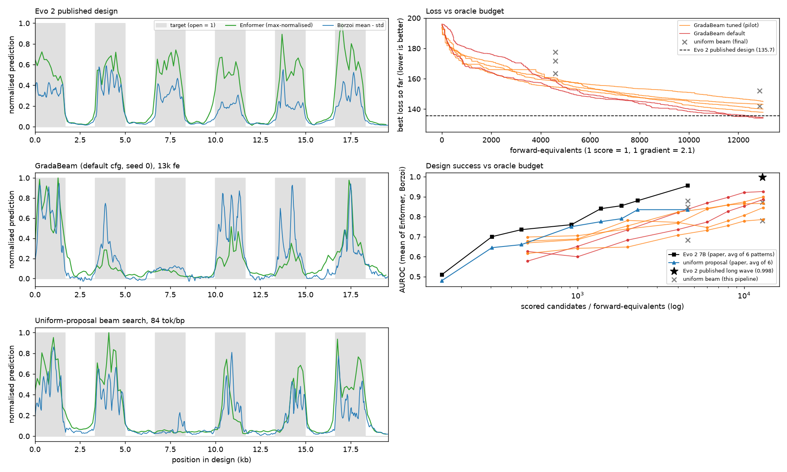
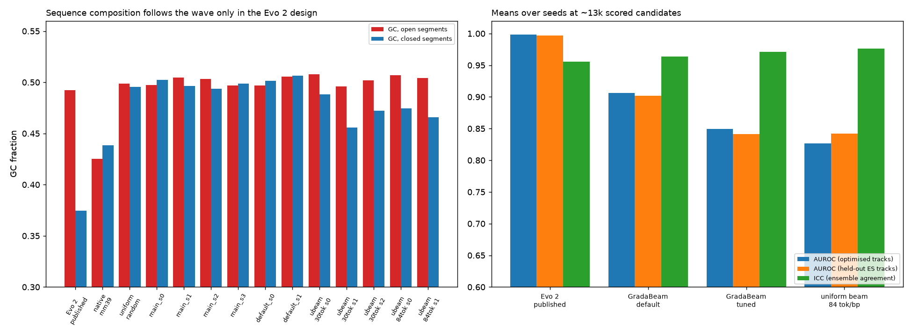
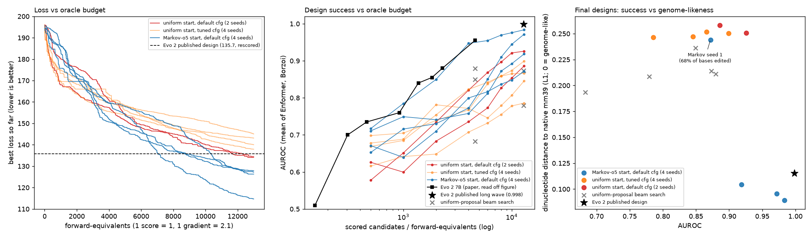
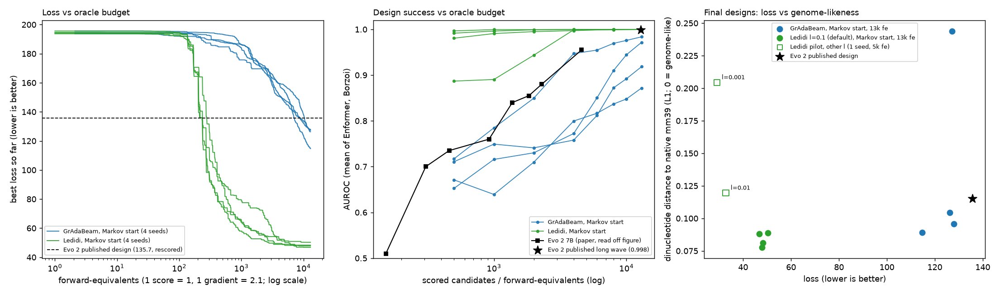

# GrAdaBeam and Ledidi on the Evo 2 long-square-wave design task

An independent test of [GrAdaBeam](https://github.com/move37-labs/gradabeam) and, in a follow-up, [Ledidi](https://github.com/jmschrei/ledidi) on the
chromatin-accessibility design task from Evo 2 (Brixi et al., *Nature* 2026, Fig. 6 and SI A.6): design a ~19.6 kb mouse DNA sequence whose predicted DNase
accessibility follows a "long square wave" (1,664 bp open, 1,664 bp closed, open first), scored by the same oracle the Evo 2
paper uses (Enformer and Borzoi).

This is a small, independent reproduction. It is not affiliated with the GrAdaBeam or Evo 2 authors, and nothing here was tested in a wet lab.

## Result in one paragraph

With about the same number of oracle evaluations as Evo 2's published long wave (~13k scored candidates), GrAdaBeam started from
**uniform-random DNA** reaches loss 134 to 145 and AUROC 0.79 to 0.93 (6 runs). The published Evo 2 design scores loss 135.7 and
AUROC 0.998 under the same oracle. GrAdaBeam matches Evo 2 on the loss in two of six runs but not on AUROC, and from a uniform start it is roughly level
with a plain uniform-proposal beam search that has no gradients and no learned prior.

A follow-up started GrAdaBeam from a sequence sampled from an **order-5 Markov chain trained on the mouse genome** (no change to GrAdaBeam
itself). With the library defaults, all four seeds reach loss 114.7 to 127.9, below the published design's 135.7, and AUROC 0.87 to 0.98
(mean 0.94), still below Evo 2's 0.998. Three of four runs also kept genome-like sequence statistics. See
[Follow-up: Markov-o5 start](#follow-up-markov-o5-start).

A second follow-up swapped the optimizer for **Ledidi** (unmodified, library defaults), started from the same four Markov sequences. All four seeds reach
loss 46.8 to 50.3 (GrAdaBeam from the same starts: 114.7 to 127.9; Evo 2's published design: 135.7) and AUROC 0.9996 to 0.9998 (Evo 2: 0.9985), editing about 5% of
bases and keeping genome-like composition. It passes Evo 2's loss after about 250 forward-equivalents. See
[Follow-up: Ledidi from the Markov start](#follow-up-ledidi-from-the-markov-start).

The oracle budget is matched. Everything else Evo 2 had is not (see [Is the comparison fair?](#is-the-comparison-fair)), so this does not show
that GrAdaBeam or Ledidi is generally worse or better than Evo 2, or that Ledidi is generally better than GrAdaBeam.

## Results

Final designs after ~13k forward-equivalents (fe). Loss is lower-is-better. AUROC is the mean of Enformer and Borzoi, as in the paper.
"Held-out" AUROC uses other mouse ES DNase tracks that the optimiser never saw (Enformer 10, 44, 45, 46; Borzoi 740, 774, 775, 776).
ICC is the agreement between Enformer and the four Borzoi replicates.

| Design | Runs | Loss | AUROC | Held-out AUROC | ICC |
|---|---|---|---|---|---|
| Evo 2 published long wave (rescored here) | 1 | 135.7 | 0.998 | 0.997 | 0.956 |
| GrAdaBeam, library defaults (beam 2, rollouts 4, rate 2.0, alpha 0.5) | 2 | 134.6, 134.1 | 0.926, 0.886 | 0.912, 0.891 | 0.96 to 0.97 |
| GrAdaBeam, pilot-tuned (beam 4, rollouts 8, rate 200, alpha 0.1) | 4 | 138 to 145 | 0.786 to 0.899 (mean 0.849) | 0.776 to 0.895 | 0.97 to 0.98 |
| Uniform-proposal chunked beam search, 84 tok/bp (K'=2, K=42) | 2 | 142.0, 152.0 | 0.873, 0.780 | 0.900, 0.784 | 0.97 to 0.98 |
| Uniform-proposal chunked beam search, 30 tok/bp (K'=2, K=15) | 3 | 163.6 to 177.6 | 0.849, 0.683, 0.880 | 0.855, 0.707, 0.872 | 0.83 to 0.95 |
| Uniform random / native mm39 region (references) | 1 each | 195.8 / 195.1 | 0.510 / 0.488 | 0.499 / 0.478 | 0.78 / 0.90 |

AUROC of the best-so-far design at intermediate budgets (6 GrAdaBeam runs): 0.58 to 0.70 at 500 fe, 0.71 to 0.82 at 4,000 fe,
0.73 to 0.87 at 6,000 fe, 0.79 to 0.93 at 13,000 fe. Loss was still decreasing at 13k fe, so these runs are not converged.
Evo 2's curve in the paper is about 0.955 at 30 tok/bp (~4.6k scored candidates), read by eye from Extended Data Fig. 10c (about ±0.02).



*Top left: Evo 2 published design. Middle left: GrAdaBeam (default, seed 0). Bottom left: uniform-proposal beam search.
Top right: best loss so far against budget. Bottom right: AUROC against budget, with Evo 2's and the paper's uniform-proposal
curves read from the paper's figure.*



*Left: GC fraction in open and closed segments. Only the Evo 2 design follows the wave in GC content. Right: seed-averaged AUROC
(optimised tracks and held-out tracks) and ICC.*

### What the designs look like

| | Evo 2 published | GrAdaBeam (6 runs) |
|---|---|---|
| GC, open / closed segments | 0.49 / 0.37 | 0.50 / 0.50 |
| CpG observed/expected | 0.64 | 0.99 to 1.04 |
| Dinucleotide statistics | genome-like | uniform-random-like |
| Edit distance from the random start | n/a | 19% to 63% |

GrAdaBeam edited a random sequence until the oracles saw a wave. The result does not have the sequence composition of natural
DNA. Held-out-track AUROC stays close to the optimised-track AUROC, so the designs are not just overfitting the two optimised
tracks, but the held-out tracks are other ES DNase experiments and are strongly correlated with the optimised ones.

## Follow-up: Markov-o5 start

The first pass started from uniform-random DNA. This follow-up asks whether a start with genome-like local statistics helps. GrAdaBeam is
used unmodified: the start sequence is sampled from an order-5 Markov chain and everything else (default settings, 13k fe, seeds 0 to 3) stays the same.

**The chain.** Each base depends on the previous 5. It was trained on mm39 chr1 to chr19 (2.40 billion 6-mers, forward strand, repeats
included, N-containing k-mers skipped). chrX is left out so the designed locus is not in the training data (the chain has only 3,072 free parameters,
so it could not memorise a locus anyway). Samples are 19,584 bp, seeded with the last 5 bp of the native upstream flank. They have GC 0.42,
CpG observed/expected about 0.19 and a dinucleotide distance to native mm39 of 0.06 to 0.07 (uniform random DNA: GC 0.50, CpG 1.0, distance 0.25).
The chain knows nothing about the target wave. Its starts score like uniform random ones: loss 193.7 to 195.6 and AUROC 0.46 to 0.64, against 193.6 to 196.0 and 0.42 to 0.57.

**Results at 13k fe** (all four seeds, one configuration, nothing dropped):

| Run | Loss | AUROC | Held-out AUROC | ICC | Bases edited | CpG o/e | Dinuc. distance to mm39 |
|---|---|---|---|---|---|---|---|
| Markov start, seed 0 | 114.7 | 0.984 | 0.974 | 0.989 | 19% | 0.59 | 0.089 |
| Markov start, seed 1 | 127.2 | 0.872 | 0.857 | 0.965 | 68% | 1.02 | 0.244 |
| Markov start, seed 2 | 127.9 | 0.972 | 0.958 | 0.987 | 16% | 0.55 | 0.096 |
| Markov start, seed 3 | 126.3 | 0.918 | 0.916 | 0.993 | 16% | 0.52 | 0.105 |
| **Markov start, mean** | **124.0** | **0.936** | **0.926** | 0.984 | | | |
| Uniform start, same config (seeds 0, 1) | 134.6, 134.1 | 0.926, 0.886 | 0.912, 0.891 | 0.96 to 0.97 | 23%, 35% | 1.04, 1.00 | 0.251, 0.258 |
| Uniform start, tuned config (4 seeds) | 137.9 to 145.0 | 0.786 to 0.899 | 0.776 to 0.895 | 0.97 to 0.98 | 19% to 63% | 0.99 to 1.04 | about 0.25 |
| Evo 2 published design (rescored) | 135.7 | 0.998 | 0.997 | 0.956 | n/a | 0.64 | 0.115 |



*Left: best loss so far. Middle: AUROC at fixed budgets (best design at each checkpoint, re-scored). Right: final AUROC against how
genome-like the design is. Evo 2's curve in the middle panel is read by eye from the paper.*

What this shows:

- **Loss.** All four Markov-start runs end below all six uniform-start GrAdaBeam runs and below the published Evo 2 design. Exact one-sided
  permutation p is 0.005 against all six uniform-start runs. That comparison mixes in the 4 runs with a different (tuned) config. Against the 2 runs
  with the same config, the smallest possible p with these counts is 0.067, and that is what was observed.
- **AUROC.** The mean is higher (0.936 against 0.906 for the same-config uniform runs and 0.849 for the tuned runs), but the spread across seeds
  is wide (0.872 to 0.984). Against the 2 same-config uniform runs, p = 0.33. This arm does not establish an AUROC gain.
  At 4,000 fe, seed 0 already had AUROC 0.947, close to Evo 2's curve (about 0.955 at 4.6k candidates). The other three had 0.76 to 0.80.
- **Held-out tracks.** Held-out AUROC stays within about 0.015 of the optimised-track AUROC in every run, so the gain is not just overfitting
  the two optimised tracks. Those held-out tracks are other ES DNase experiments and share most of their signal with the optimised ones.
- **Genome-likeness.** Seeds 0, 2 and 3 edited only 16% to 19% of bases and kept CpG depletion (0.52 to 0.59, Evo 2: 0.64), a dinucleotide
  distance of 0.09 to 0.10 (Evo 2: 0.115), and a GC content that is higher in open than in closed segments (0.45 against 0.43), a weaker version of
  Evo 2's 0.49 against 0.37. Seed 1 edited 68% of bases, drifted to uniform-like statistics, and had the lowest AUROC of the four.
- **Why it helps is not established.** Before the runs I measured how well the oracle gradient predicts real single-base substitutions
  (150 substitutions at each of 3 starts per arm). The Markov starts are no better: Spearman 0.53 against 0.50, sign agreement 0.68 for both. So
  better gradients at the start do not explain the gain. Fewer edits and a preserved genome-like background may matter, but this was not tested.

Cost: about $2.94 of GPU time per run by the ledger ($11.8 for the four), 69.5 minutes each with four runs in parallel, plus about $0.5 for the
start checks and evaluation. Reproduce with `launch_markov.sh` after `fetch_autosomes.sh` and `train_markov.py`.

## Follow-up: Ledidi from the Markov start

[Ledidi](https://github.com/jmschrei/ledidi) (Schreiber et al., bioRxiv 10.1101/2025.04.22.650035) is a different edit-design method. It learns a weight
matrix over a template sequence, draws batches of hard one-hot samples through a Gumbel-softmax straight-through estimator, runs the frozen
differentiable oracle on them, and minimises the oracle loss plus `l` times the number of edited positions. This follow-up uses Ledidi in place of
GrAdaBeam and keeps everything else the same.

**Setup.**

- Ledidi 2.2.0 from PyPI, unmodified, with library defaults: `l=0.1`, batch 16, AdamW with lr 1.0, Gumbel temperature 1. The template is the Markov-o5 start.
  Seeds 0 to 3 use the same four start sequences as the GrAdaBeam Markov runs (checked byte for byte), so each Ledidi run pairs with a GrAdaBeam run.
  The oracle, loss, metrics, held-out tracks and budget accounting are the same as before.
- The oracle is wrapped as a torch Module (`squarewave/ledidi_oracle.py`). A custom autograd Function decodes Ledidi's one-hot samples, calls the Modal app
  once per design (4 in parallel), returns the paper loss as the model output, and returns the remote gradient as the backward pass. Ledidi's output loss is the
  batch mean of the paper loss. On the real oracle the wrapper's losses match direct calls and its gradients match direct gradients to 1e-7.
- Budget: 1 fe to score the template, then 386 steps x 16 designs x 2.1 fe = 12,970.6 fe (6,176 gradient calls, no non-finite gradients). `max_iter` is set from
  the budget (Ledidi's default of 1,000 steps would need 33.6k fe) and early stopping is off, so every run spends the whole budget.
- Which design counts: the best oracle loss over every design scored during the run, the same rule as the GrAdaBeam runs. Ledidi's own returned batch
  (chosen by batch-mean total loss) is scored separately below.
- Choosing `l`. The paper loss (100 to 200) is far from the scale Ledidi's default was set for, so one pilot per value was run first on seed 100, which the
  main runs do not use (5k fe each). An edit is favoured when its first-order loss drop exceeds `l`. At the seed-0 start that holds for 1.5% of positions at
  `l=0.1`, 21% at 0.01 and 61% at 0.001.

  | `l` (pilot, seed 100, 5k fe) | Loss | AUROC | Held-out AUROC | Bases edited | Dinuc. distance to mm39 |
  |---|---|---|---|---|---|
  | **0.1 (library default)** | 53.6 | 1.000 | 1.000 | 4.8% | 0.072 |
  | 0.01 | 32.8 | 1.000 | 1.000 | 15.9% | 0.119 |
  | 0.001 | 29.0 | 1.000 | 1.000 | 26.0% | 0.204 |

  The default was kept for the main runs. It is the most conservative of the three (fewest edits, most genome-like), not the one with the lowest loss.
  Smaller `l` reached lower loss in the pilot, so the numbers below are not the lowest loss Ledidi can reach here.

**Results at 13k fe** (all four seeds, one configuration, nothing dropped):

| Run | Loss | AUROC | Held-out AUROC | ICC | Bases edited | CpG o/e | Dinuc. distance to mm39 |
|---|---|---|---|---|---|---|---|
| Ledidi, Markov start, seed 0 | 47.8 | 0.9996 | 0.9996 | 0.998 | 5.4% | 0.28 | 0.078 |
| Ledidi, Markov start, seed 1 | 48.3 | 0.9998 | 0.9995 | 0.998 | 5.0% | 0.29 | 0.081 |
| Ledidi, Markov start, seed 2 | 46.8 | 0.9998 | 0.9998 | 0.998 | 5.6% | 0.28 | 0.088 |
| Ledidi, Markov start, seed 3 | 50.3 | 0.9997 | 0.9997 | 0.997 | 5.6% | 0.28 | 0.089 |
| **Ledidi, mean** | **48.3** | **0.9998** | **0.9996** | 0.998 | | | |
| GrAdaBeam, Markov start, same four starts (mean) | 124.0 | 0.936 | 0.926 | 0.983 | 16% to 68% | 0.52 to 1.02 | 0.089 to 0.244 |
| Evo 2 published design (rescored) | 135.7 | 0.9985 | 0.9969 | 0.956 | n/a | 0.64 | 0.115 |



*Left: best loss so far against budget (log axis). Middle: AUROC of the best design at fixed budgets (re-scored). Right: final loss against how genome-like
the design is, with the pilot runs for the other `l` values (one seed, 5k fe). Evo 2's curve in the middle panel is read by eye from the paper.*

What this shows:

- **Loss.** All four Ledidi runs end at 46.8 to 50.3, against 114.7 to 127.9 for GrAdaBeam from the same starts and 135.7 for the published Evo 2 design.
  With 4 runs against 4, the smallest possible exact permutation p is 0.014 one-sided (0.029 two-sided), and that is what was observed.
- **Speed.** Ledidi's best loss drops below Evo 2's 135.7 after 234 to 280 fe. GrAdaBeam from the same starts needs 7,048 to 10,372 fe. At 4,000 fe all four
  Ledidi runs have loss 48.9 to 53.5 and AUROC 0.997 or higher. GrAdaBeam at 4,000 fe has loss 150.7 to 159.6 and AUROC 0.76 to 0.95. From 4k to 13k fe Ledidi's
  loss improves by only 1.1 to 5.1 (13,000 fe: 46.8 to 50.3), so these runs are close to converged at this budget.
- **AUROC.** 0.9996 to 0.9998 against Evo 2's 0.9985 and GrAdaBeam's 0.87 to 0.98 (permutation p as for loss). Both Ledidi and Evo 2 are at the ceiling of this metric,
  so the small difference between them should not be read as meaningful. The loss gap is the informative number.
- **Selection.** The best-over-all-scored rule is not what drives this. The batch Ledidi itself returns (16 samples, chosen by batch-mean total loss) has mean loss
  52.8 to 56.6 across the four runs (best sample in each batch 50.1 to 54.5) and mean AUROC 0.997 to 1.000 (`results/ledidi_batch_eval.json`).
- **Edits and genome-likeness.** Ledidi edited 5.0% to 5.6% of bases (about 1,000 to 1,100 of 19,584), against 16% to 68% for GrAdaBeam, and kept the start's local
  statistics: CpG observed/expected 0.28 (the Markov start is about 0.19, Evo 2 is 0.64), dinucleotide distance 0.078 to 0.089 (Evo 2: 0.115), and GC higher in open
  than in closed segments (0.45 against 0.41, Evo 2: 0.49 against 0.37). Nothing drifted toward uniform-like sequence as GrAdaBeam's seed 1 did.
- **Held-out tracks.** Held-out AUROC is 0.9995 to 0.9998, but those tracks share both models and the cell type with the optimised ones, so they are a weak test (see Limits).

What this does not show:

- **Why Ledidi is better here.** No ablation was run. One hypothesis: each Ledidi step applies the oracle gradient at all 19.6k positions at once (about 1,000 edits per
  sample, 16 samples per step, with Adam momentum), while GrAdaBeam's rollouts change about two bases per proposal, so for the same number of oracle calls Ledidi can move much
  further. This was not tested.
- **That Ledidi beats GrAdaBeam in general.** GrAdaBeam ran with library defaults from the Markov start (the earlier tuning pilots were done from uniform starts, and the
  tuned configuration did not help there). This is one task, one oracle and one budget.
- **What the Markov start contributes to Ledidi.** Ledidi was only run from the Markov start. A uniform start was not tried, so the start's role for Ledidi is unknown.
- **That the designs work as chromatin.** They are scored by the same two models that guided Ledidi, and nothing here was tested in a wet lab. No model outside the
  optimisation loop was used. The natural-looking composition argues against gross artefacts, but it is not a test.

Notes:

- Borzoi's backward pass peaks at 55.6 GB per design on an H100, so only one design fits per call. The wrapper therefore sends one design per call. A call with
  two or three designs runs out of GPU memory, and the container then keeps that memory until it scales down (about 30 s idle), so retries against a warm container also fail.
- `analyze_runs.py` checks that its re-score of a design matches the optimizer's own loss. The tolerance was 0.05 absolute, set for losses near 130. At losses near 47 one
  design differed by 0.052 (0.11%), so the tolerance is now relative (0.25%). Across the 24 Ledidi designs re-scored the largest difference is 0.052. Repeat re-scores of
  the same sequence vary by about 0.04, which is fp16 Borzoi numerics.
- Cost: $3.02 of GPU time per run by the ledger ($12.1 for the four), about 45 minutes each with four runs in parallel, plus $3.5 for the three pilots and under $0.5 for evaluation.
  Reproduce with `launch_ledidi_pilot.sh` and `launch_ledidi.sh` (see [Reproduce](#reproduce)). Costs are estimates from the GPU-time ledger, not invoices.

## Setup

- **Region.** mm39 chrX:52,051,929-52,123,468. The native upstream and downstream flanks are fixed. Design length 19,584 bp, the
  length of the published long wave in Supplementary Data 3.
- **Oracle.** Enformer (mouse head, DNASE:129 ES-E14, track 11) and Borzoi mouse replicates 0 to 3 (track 741, mean minus std over
  replicates), max-normalised, L1 loss on the design bins, averaged: `f = (f_enformer + f_borzoi) / 2`.
- **Oracle validation.** The published Evo 2 long wave scores loss 135.71 (the proto-tools predictors give 135.70), AUROC 0.998, ICC
  0.956 (the paper reports about 0.95). Uniform random DNA scores 195.84.
- **Gradients.** GrAdaBeam needs `tism_torch`. The custom Modal oracle returns the loss and its gradient with respect to the one-hot
  input. Against real single-base substitutions the gradient has correlation 0.63 and sign agreement 0.83. Borzoi runs in fp16
  autocast, so the gradient uses a loss-scale backoff (default 64). A zero gradient is used only as a last resort and is counted
  (`n_bad_grad`, zero in the reported runs).
- **Budget unit.** Forward-equivalents. One scored candidate is 1 fe and one gradient is 2.1 fe, the measured H100 time ratio. Evo 2's
  long wave is 153 chunks x K'=2 x K=42 = 12,852 scored candidates. The GrAdaBeam runs use 13,000 fe, which is about 9.2k to 10.7k
  scored candidates plus 1.1k to 1.8k gradients.
- **Start.** Uniform-random ACGT per seed in the first pass, and not made easier. The follow-up uses an order-5 Markov start instead (see above).
- **GrAdaBeam.** The unmodified [`move37-labs/gradabeam`](https://github.com/move37-labs/gradabeam) at commit `1115891`,
  driven from Python. `PYTHONHASHSEED` is set to the seed because GrAdaBeam breaks ties through set iteration.
- **Tuning.** Two short pilots on seeds 100 and 101 (never reused for the main runs): mutations per sequence at 2k fe, then 8
  configurations at 3k fe. The tuned configuration did worse than the defaults at 13k fe (mean AUROC 0.85 against 0.91, but 4 and 2
  seeds, so this is not a significant difference).
- **Control.** A re-implementation of the paper's chunked beam search with a uniform-over-ACGT proposal in place of Evo 2
  (`uniform_beam.py`). At 30 tok/bp it gives AUROC 0.849, 0.683 and 0.880 (mean 0.804). The paper reports about 0.835 for its uniform
  generator at that budget, so this pipeline reproduces the paper's search behaviour. Partial designs are scored with the native
  sequence as the fill, which is an assumption about the paper's masking.

## Is the comparison fair?

The oracle budget is matched. Evo 2 also had advantages that GrAdaBeam did not:

- A pretrained 7B DNA model as the proposal, which is a strong prior. GrAdaBeam started from noise.
- A native 40,960 bp prompt of genomic context.
- About 1.6M generated tokens of generator compute on top of the oracle calls. This repo does not count generator compute.
- Settings tuned for this task, and a published design that was probably selected from several attempts.

GrAdaBeam had oracle gradients (charged at 2.1 fe) and only a small amount of tuning.

The most defensible reading: from a uniform start, GrAdaBeam is about level with a no-prior uniform beam search under this oracle and budget, and the gap
to Evo 2's AUROC is likely mostly Evo 2's prior. The Markov-o5 follow-up supports that: giving GrAdaBeam a cheap, genome-trained prior (CPU minutes,
no learned long-range structure) lowers its loss below the published design and moves its AUROC up toward Evo 2's, though not to it. With 2 to 6 seeds per arm and a wide spread between seeds (AUROC 0.79 to 0.90
within the uniform-start tuned arm, 0.87 to 0.98 in the Markov arm), small differences between GrAdaBeam variants should not be read as real.

The Markov follow-up was run after seeing the first-pass results, with one configuration and the seeds fixed in advance (0 to 3). All four seeds are reported.

The Ledidi follow-up has the same structure: a matched oracle budget, a cheap Markov start in place of Evo 2's 7B prior, and gradients charged at 2.1 fe. Its
advantage over GrAdaBeam is large (loss 48 against 124), and its loss is far below Evo 2's published design. All three numbers are measured on one oracle that
Ledidi and GrAdaBeam optimised directly and Evo 2 did not, so the loss comparison with Evo 2 favours the two gradient methods. Evo 2's design came from a generative
model that never saw an oracle gradient, so a method that reads the gradient is a different kind of method. The comparison shows what each approach reaches on this
oracle at this budget. It does not show which is the better generator. The `l` pilot used a separate seed (100), and the default `l` was kept for all four reported seeds.

## Limits

- The Borzoi mouse replicates here are the standard models, not Flashzoi as in the paper.
- The Evo 2 baseline numbers are rescores of the published sequence or values read off a figure.
- Only the long square wave was tested, with one oracle pairing and 13k fe. It was not run with more budget, so the claim is limited
  to this budget.
- GrAdaBeam and Ledidi optimised directly on the scoring oracle used here. Evo 2's design was produced with the paper's pipeline (Flashzoi-based Borzoi) and is
  only rescored here, which favours both on loss. The AUROC gap to Evo 2 for GrAdaBeam (0.87 to 0.98 against 0.998) is not affected by that in the same way, but it is still measured on this oracle.
- No model outside the optimisation loop was used to score the Ledidi or GrAdaBeam designs. The held-out tracks come from the same two models and the same cell type, so they
  test overfitting to two specific tracks, not whether the designs would hold up under a different model.
- Ledidi was run only from the Markov start, with one `l` for the four reported seeds (the other two `l` values are single-seed 5k-fe pilots).
- Evo 2's own run was not reproduced. No wet-lab data.
- Modal cost for the first pass was roughly $50, the Markov follow-up added about $12, and the Ledidi follow-up about $16 (pilots $3.5, four runs $12.1, evaluation a few tens of cents) by the GPU-time ledger (estimates, not invoices).

## Reproduce

```bash
python -m venv .venv && . .venv/bin/activate
pip install -r requirements.txt
git clone https://github.com/move37-labs/gradabeam && git -C gradabeam checkout 1115891
pip install -e gradabeam          # or just put it on PYTHONPATH
export GRADABEAM_PATH=$PWD/gradabeam

python fetch_flanks.py            # downloads UCSC mm39 chrX and checks data/*.txt (optional, files are committed)
modal setup                       # once
modal deploy squarewave/oracle_server.py [--env <env>]
export MODAL_ENVIRONMENT=<env>    # same env as the deploy; leave unset for the default

# one run: 13k fe, default GrAdaBeam settings
PYTHONHASHSEED=0 PYTHONPATH=.:$GRADABEAM_PATH python run_gradabeam.py --seed 0 --budget-fe 13000 --name my_run --beam-size 2 --rollouts 4 --mut-rate 2.0 --alpha 0.5
./launch_main.sh                  # all main runs (GRADABEAM_PATH must be set); also launch_ubeam.sh, launch_pilot*.sh

# Markov-o5 start: download chr1-19 (~750 MB), train the chain (a minute on a laptop), run 4 seeds
sh fetch_autosomes.sh && PYTHONPATH=. python train_markov.py
./launch_markov.sh                # or: run_gradabeam.py ... --start markov
PYTHONPATH=.:$GRADABEAM_PATH python analyze_runs.py markov_default_s0 markov_default_s1 markov_default_s2 markov_default_s3 --out results/analysis_markov.json
python make_markov_figure.py
PYTHONPATH=. python analyze_runs.py main_s0 main_s1 --fe 500 1000 2000 4000 8000 13000

# Ledidi from the Markov start (needs the Markov model above; no GrAdaBeam checkout needed)
pip install -r requirements-ledidi.txt
./launch_ledidi_pilot.sh          # l pilot on seed 100, 5k fe each
PYTHONPATH=. python analyze_runs.py ledidi_pilot_l0.1 ledidi_pilot_l0.01 ledidi_pilot_l0.001 --fe 1000 2000 5000 --out results/analysis_ledidi_pilot.json
./launch_ledidi.sh                # 4 seeds, library defaults, 13k fe
PYTHONPATH=. python analyze_runs.py ledidi_markov_s0 ledidi_markov_s1 ledidi_markov_s2 ledidi_markov_s3 --out results/analysis_ledidi.json
PYTHONPATH=. python eval_ledidi_batch.py ledidi_markov_s0 ledidi_markov_s1 ledidi_markov_s2 ledidi_markov_s3
python make_ledidi_figure.py
modal app stop gradabeam-squarewave ${MODAL_ENVIRONMENT:+-e $MODAL_ENVIRONMENT}   # when done
```

Each 13k-fe GrAdaBeam run took about 98 minutes of wall time (first pass; 69.5 minutes for the Markov runs) and ~$3 of GPU time by the ledger. Each Ledidi run took about
45 minutes with four in parallel and ~$3 of GPU time. Baselines and `make_figure.py` need the Evo 2
published long wave, which is not redistributed here (see [`data/README.md`](data/README.md)).

## Layout

- `squarewave/oracle_server.py`: Modal app `gradabeam-squarewave` (Enformer fp32 service and Borzoi 4-replicate service; `score`, `score_and_grad`, `raw_tracks`).
- `squarewave/remote.py`, `gb_oracle.py`: threaded client with retry and a GPU-time ledger; GrAdaBeam oracle (`get_tism` is first-order loss differences).
- `squarewave/scoring.py`, `metrics.py`, `evaluate.py`: the paper's metrics (loss, AUROC, ICC), held-out-track AUROC and sequence statistics, in plain numpy.
- `run_gradabeam.py`, `uniform_beam.py`, `launch_*.sh`: GrAdaBeam runs and the uniform-proposal control.
- `squarewave/markov.py`, `train_markov.py`, `fetch_autosomes.sh`, `launch_markov.sh`, `markov_start_check.py`: the order-5 Markov start (training, sampling, start and gradient checks, runs).
- `squarewave/ledidi_oracle.py`, `run_ledidi.py`, `launch_ledidi.sh`, `launch_ledidi_pilot.sh`, `requirements-ledidi.txt`: the oracle as a torch Module for Ledidi, the run script (same
  outputs as `run_gradabeam.py`), launchers for the `l` pilot and the four main runs.
- `squarewave/budget.py`, `starts.py`: the fe constants and the start-sequence generator shared by both run scripts.
- `analyze_runs.py`, `baselines.py`, `eval_ubeam.py`, `eval_ledidi_batch.py`, `make_figure.py`, `make_markov_figure.py`, `make_ledidi_figure.py`: analysis and figures.
- `phase1_*.py`, `phase2_*.py`: oracle validation (proto-tools check, latency, gradient check).
- `results/`: per-run traces, milestone designs and best sequences (`runs/`), control runs (`uniform_beam/`), analysis JSON, figures, logs.

## Credits and licenses

Code in this repo is MIT-licensed ([LICENSE](LICENSE)). GrAdaBeam and Ledidi are Apache-2.0 and are used unmodified (Ledidi 2.2.0 from PyPI). Enformer, Borzoi and Evo 2 belong to
their authors. The Evo 2 paper is CC BY-NC-ND 4.0, which is why its sequences are not included here. Genome sequence is from UCSC mm39.

- Brixi et al., *Genome modelling and design across all domains of life with Evo 2*, Nature 2026.
- Avsec et al., Enformer, *Nature Methods* 2021. Linder et al., Borzoi, *Nature Genetics* 2025.
- GrAdaBeam preprint and code: [move37-labs/gradabeam](https://github.com/move37-labs/gradabeam).
- Ledidi: Schreiber et al., bioRxiv 10.1101/2025.04.22.650035; code: [jmschrei/ledidi](https://github.com/jmschrei/ledidi).
